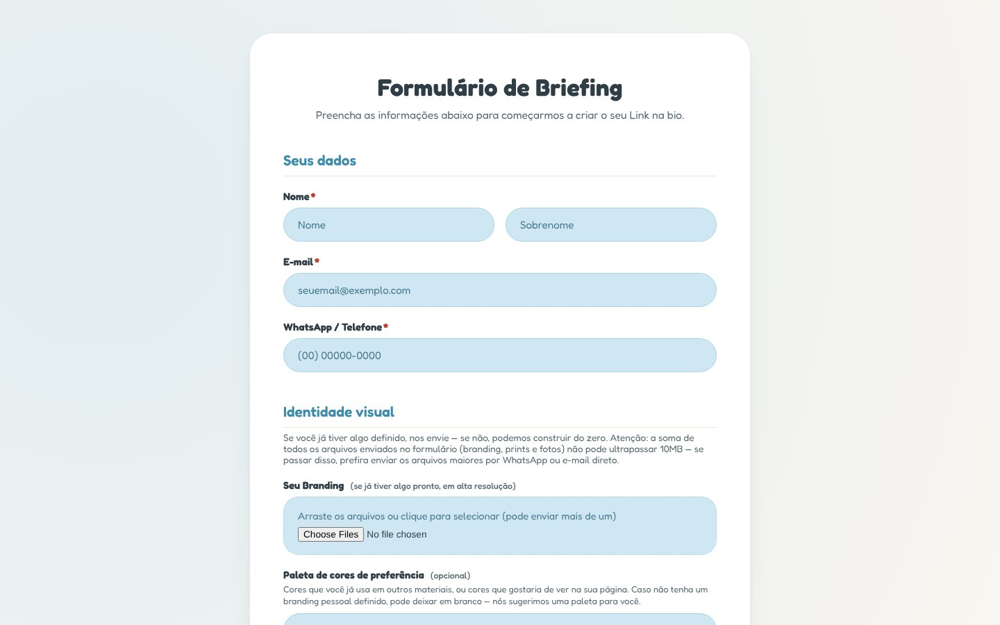
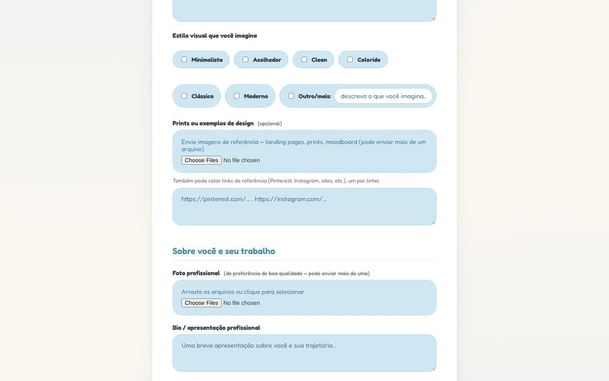
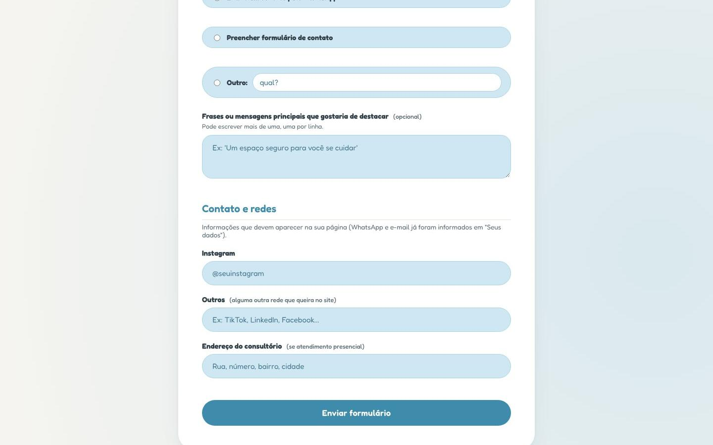
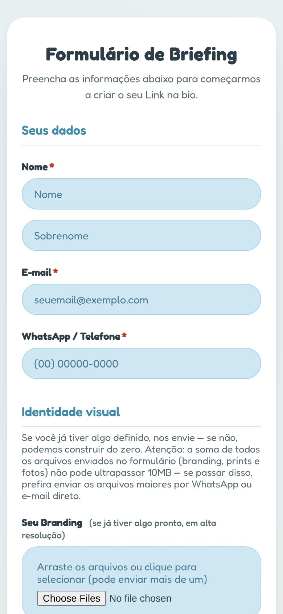

# Forms for Psychologists — Briefing Form

A briefing form that psychologists fill in before their link-in-bio page is designed: personal details, visual identity, references, practice, page goal and contact info, with file uploads. Interface in Portuguese.

**Live:** [formsparapsi.vercel.app](https://formsparapsi.vercel.app)



## What's inside

| Section | What it asks for |
| --- | --- |
| **Seus dados** | Name, email and WhatsApp / phone (required). |
| **Identidade visual** | Existing branding files, preferred colors and typography. |
| **Referências** | Sites the psychologist admires, visual style (minimalist, welcoming, clean, colorful, classic, modern or other), reference images and links. |
| **Sobre você e seu trabalho** | Professional photo, bio, training and therapeutic approach, audience and services. |
| **Objetivo da página** | What visitors should do: book a session, message on WhatsApp, fill a contact form or something else; key messages to highlight. |
| **Contato e redes** | Instagram, other networks and office address. |

Submissions, including attached files (10 MB in total), are delivered by email through [FormSubmit](https://formsubmit.co), with a honeypot field against spam and a table-formatted email template.

<table>
  <tr>
    <td></td>
    <td></td>
  </tr>
  <tr>
    <td colspan="2" align="center"></td>
  </tr>
</table>

## Built with

- Plain **HTML** and **CSS**, no JavaScript and no build step
- **FormSubmit** for email delivery and file attachments
- **Fredoka** and **Inter** from Google Fonts
- Deployed on **Vercel**

## Project structure

```
.
├── index.html    # the form: markup and styles
├── favicon.svg
├── docs/         # screenshots used in this README
└── README.md
```

## Run locally

No install needed. Open `index.html` in a browser, or serve the folder:

```bash
npx serve .
```

To receive submissions yourself, change the address in the form's `action` (`https://formsubmit.co/<your-email>`) and confirm the activation email FormSubmit sends on the first submission.

## Contact

- [LinkedIn](https://www.linkedin.com/in/fl%C3%A1vio-veloso-a29b02254/)
- [X @flaviovlso](https://x.com/flaviovlso)
- [github.com/flaviohcveloso](https://github.com/flaviohcveloso)

---

© 2026 Flávio Veloso. All rights reserved.
